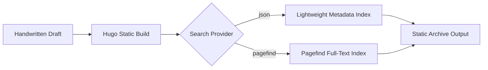

+++
title = 'Offline Archiving & Signal Verification'
date = 2026-11-22T09:30:00+08:00
draft = false
archiveId = '#SIG-01'
tags = ['Tech', 'Archive']
summary = 'Demonstrates the table of contents, inline and block KaTeX equations, and Mermaid flowchart rendering.'
math = true
diagrams = true
+++

This technical note showcases Aftermind's multi-level headings (triggering the sticky desktop rail TOC and collapsible mobile TOC), per-article math equations, and Mermaid diagrams.

## Decay Model

When a system stops receiving external feedback, silence intervals \( \Delta t_n = t_n - t_{n-1} \) often follow a heavy-tailed distribution. Letting \(w_n\) denote the weight of the \(n\)-th entry, cumulative resonance can be written as:

$$
R(N) = \sum_{n=1}^{N} w_n \, e^{-\lambda \Delta t_n}
$$

Here \(\lambda > 0\) represents the everyday forgetting rate. Articles without `math = true` load zero KaTeX assets.

## Archival Pipeline

### Graceful Degradation

If external scripts are unreachable or a diagram contains invalid syntax, Aftermind preserves the original Markdown code fence and TeX source inline so reading remains uninterrupted.
