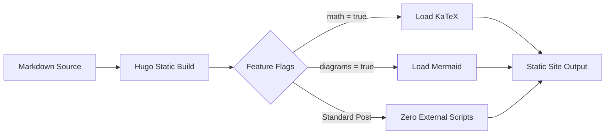
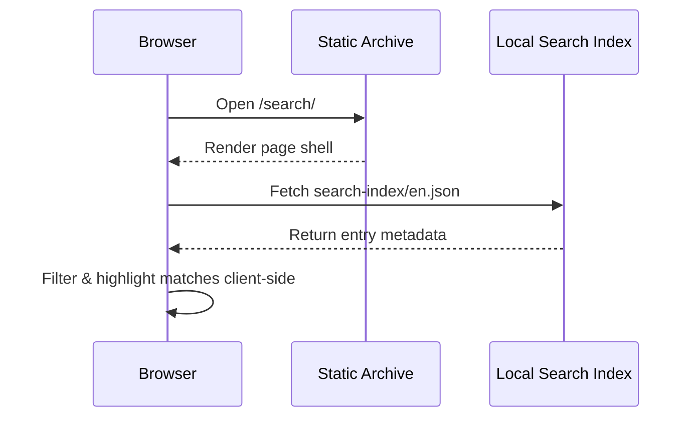
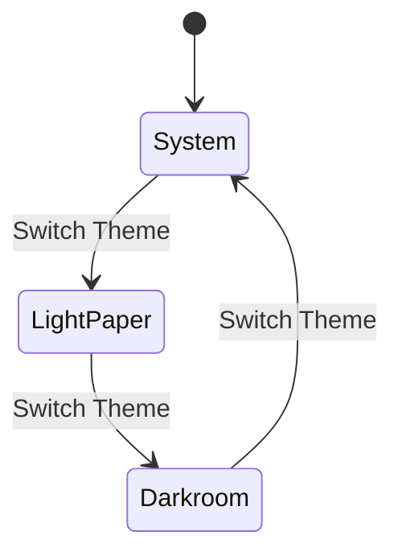

+++
title = 'Rich Content, Diagrams & Lightbox Showcase'
date = 2026-11-18T14:15:00+08:00
draft = false
tags = ['Guide', 'Diagrams', 'Rich Content']
summary = 'Showcases Mermaid diagrams, semantic HTML rich text (details, keyboard hints, highlights), the image lightbox, and built-in shortcodes.'
diagrams = true
+++

Beyond plain prose and TeX math, Aftermind supports on-demand Mermaid diagrams, semantic HTML elements, and an accessible image lightbox.

## Mermaid Diagrams

When `diagrams = true` is set in front matter, fenced `mermaid` code blocks render as theme-aware SVGs that adapt automatically to light and dark modes.

### Flowchart

### Sequence Diagram

### State Diagram

## Semantic HTML Elements

With `markup.goldmark.renderer.unsafe = true`, standard semantic HTML works cleanly inside prose:

### Collapsible Details (`
`)

Expand archival deployment checklist

1. Update `baseURL` to your production domain.
2. Adjust `[pagination] pagerSize` to fit your archive density.
3. If using Pagefind, run `npx pagefind --site public` after building.

### Keycaps & Inline Annotations (`<kbd>` / `<mark>` / `<abbr>`)

Move focus with <kbd>Tab</kbd> or dismiss the lightbox with <kbd>Esc</kbd>. Emphasize local notes with <mark>highlighted text</mark>, and annotate abbreviations like <abbr title="Table of Contents">TOC</abbr> or <abbr title="Really Simple Syndication">RSS</abbr>.

## Images & Lightbox

Open [The Vending Machine Still Gives Change]() and click the cover photograph to inspect it in the lightbox, then press <kbd>Esc</kbd> to close.
