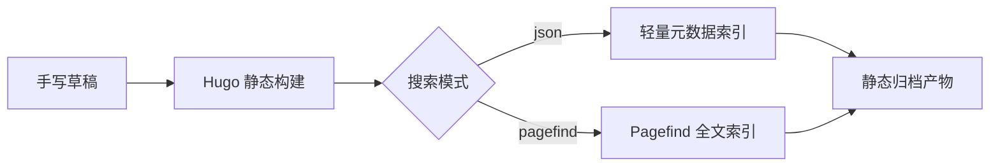

+++
title = '离线归档与信号校验'
date = 2026-11-22T09:30:00+08:00
draft = false
archiveId = '#SIG-01'
tags = ['技术', '归档']
summary = '演示文章目录、行内与块级数学公式（KaTeX），以及 Mermaid 流程图渲染。'
math = true
diagrams = true
+++

这是一篇演示技术札记特性的示例文章：包含多级标题（触发桌面左轨与移动端折叠目录）、按篇开启的数学公式与 Mermaid 图表。

## 衰减模型

当系统不再接收外部反馈时，静默间隔 \( \Delta t_n = t_n - t_{n-1} \) 往往呈长尾分布。若记第 \(n\) 条记录的权重为 \(w_n\)，则累计余响可写为：

$$
R(N) = \sum_{n=1}^{N} w_n \, e^{-\lambda \Delta t_n}
$$

其中 \(\lambda > 0\) 表示日常遗忘速率，单篇未启用 `math = true` 时不会加载 KaTeX 资源。

## 归档管线

### 降级说明

若远程脚本不可达或图表语法有误，主题会自动保留原始 Markdown 代码围栏与 TeX 源码，不影响正文阅读。
