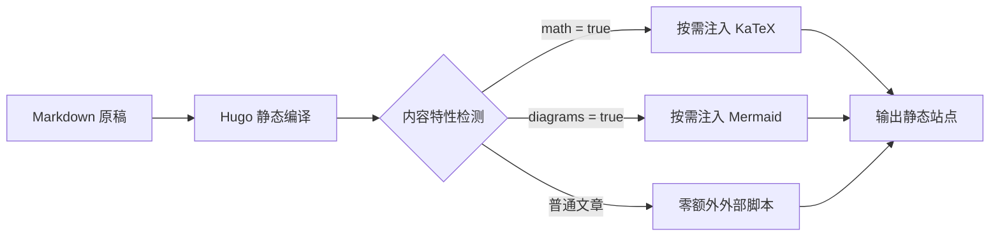
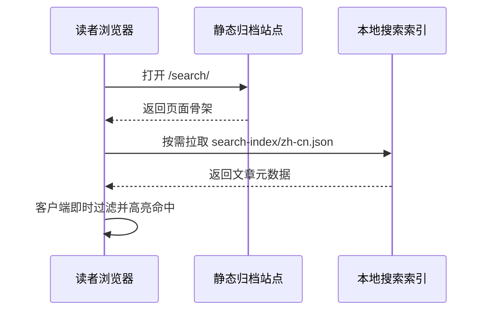
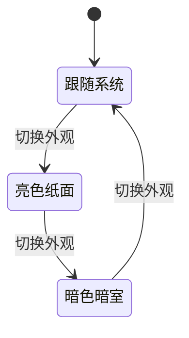

+++
title = '富文本、图表与媒体展示'
date = 2026-11-18T14:15:00+08:00
draft = false
tags = ['指南', '图表', 'Rich Content']
summary = '演示 Mermaid 多类型图表、语义化 HTML 富文本（折叠块、快捷键、高亮标注）以及图片灯箱与内置短代码的使用方式。'
diagrams = true
+++

除了纯文本与数学公式，Aftermind 还支持按需渲染的 Mermaid 图表、语义化 HTML 富文本组件以及内置图片灯箱。

## Mermaid 图表

在 Front Matter 中设置 `diagrams = true` 后，带有 `mermaid` 语言标记的代码围栏会自动渲染为随亮/暗主题自适应的 SVG 图表。

### 流程图（Flowchart）

### 时序图（Sequence Diagram）

### 状态图（State Diagram）

## 语义化 HTML 富文本

当 `markup.goldmark.renderer.unsafe = true` 开启时，可以直接使用标准 HTML 语义标签补充表达：

### 折叠面板（`
`）

展开查看归档校验清单

1. 确认 `baseURL` 已更新为正式域名。
2. 检查 `[pagination] pagerSize` 是否符合文章密度。
3. 若使用 Pagefind，构建后执行 `npx pagefind --site public`。

### 按键提示与标记（`<kbd>` / `<mark>` / `<abbr>`）

在归档阅读过程中，可以使用 <kbd>Tab</kbd> 移动焦点，或通过 <kbd>Esc</kbd> 关闭图片灯箱。需要强调的局部结论可以用 <mark>标记高亮</mark>，缩写术语如 <abbr title="Table of Contents">TOC</abbr> 与 <abbr title="Really Simple Syndication">RSS</abbr> 支持原生提示。

## 图片与灯箱

前往[《自动售货机还在找零》]()，点击文章封面可打开灯箱，按 <kbd>Esc</kbd> 关闭。
